# Patient Dashboard Migration: PHP → React + TypeScript

> **Live:** http://<deployed-host>:8430/dashboard, a separate service next to the Week 2 Co-Pilot
> (which stays at `:8420`, untouched). Log in with an OpenEMR account; the default patient is the
> synthetic demo patient Dana Demopatient (DASH-0001).
>
> **Code:** branch `feat/patient-dashboard`, [MR !18](https://labs.gauntletai.com/taylorclements/openemr-base-clean_clem/-/merge_requests/18). This document ships to `main` on its
> own, as a docs-only change with no application code, so it can be read before the code merges. The
> code merges into `main` only after Week 2 grading, so the graded Week 2 app can't change underneath
> the graders. File paths below (`clinical-copilot/app/dashboard/…`, `clinical-copilot/dashboard/…`,
> `evals/dashboard_unit_tests.py`, the `dashboard_checks` CI job) refer to that branch.

## 1. Summary

OpenEMR's patient dashboard (`interface/patient_file/summary/demographics.php`, 2,080 lines of
PHP that renders HTML on the server) was ported to a **React 18 + TypeScript + Vite** single-page
app. The new app reads every piece of patient data from **OpenEMR's existing FHIR API**, under
the logged-in user's own OAuth token.

The port covers:
- the persistent patient header;
- the five required clinical cards (Allergies, Medical Problems, Medications, Prescriptions,
  Care Team);
- **Vitals** as the additional section;
- OAuth2 / OpenID Connect login.

**The approach in one paragraph.** The React app doesn't call OpenEMR directly. A small
**backend-for-frontend (BFF)** does: a Python package (`clinical-copilot/app/dashboard/`)
inside the project's existing FastAPI server. It holds the OAuth tokens server-side, calls
FHIR, applies the same "what counts as active" rules the PHP page applies, and returns one small,
display-ready JSON object per card. The browser only renders those objects. **OpenEMR's code,
database and API are untouched** (§4).

## 2. What was ported

| Challenge requirement | Where | Notes |
|---|---|---|
| **Authentication**: OAuth2/OIDC | `/login` → OpenEMR's authorize page → `/callback` (authorization code + PKCE S256) | Tokens stay on the server. The browser holds only an httpOnly session cookie. `POST /logout` and a server-side idle timeout (7200 s, OpenEMR's own default) were added. |
| **Patient header**: name, DOB, sex, MRN, active status | `GET /dashboard/api/header` → `PatientHeader.tsx` | MRN = the identifier typed `PT`. Age is computed on the server. Shows a **Deceased** badge when FHIR says so. |
| **Allergies** | `/allergies` → `AllergiesCard.tsx` | Risk label, with high risk highlighted as in PHP |
| **Problem List** ("Medical Problems", OpenEMR's label) | `/problems` → `ProblemsCard.tsx` | |
| **Medications** | `/medications` → `MedicationsCard.tsx` | `MedicationRequest` with intent `plan` |
| **Prescriptions** | `/prescriptions` → `PrescriptionsCard.tsx` | `MedicationRequest` with intent `order`; PHP's table columns |
| **Care Team** | `/care-team` → `CareTeamCard.tsx` | Member and facility names are resolved on the server when the signed-in account has OpenEMR's `admin/users` permission; otherwise the member shows "Name unavailable" (§7 row 20b) |
| **Additional section: Vitals** | `/vitals` → `VitalsCard.tsx` | Formatted exactly like PHP's `report.php` |

Every card reads live data through the FHIR API (`/apis/default/fhir/...`). There's no database
access and no call to the older REST API.

## 3. Why React + TypeScript + Vite

### The choice criteria

1. **A typed contract with a Python backend.** The data layer is Python (FastAPI + Pydantic). The
   frontend needed a way to consume *those* types without writing them twice.
2. **One runtime in production.** The server already exists (the Clinical Co-Pilot's FastAPI app,
   hardened and deployed under systemd). The frontend should be static files that server can
   host. No second server process, no second deploy target, no CORS.
3. **Per-card loading and failure**, because a clinical page must never show an error as "no
   allergies" (§5.1).
4. **Maintainability and hiring:** a mainstream stack a future OpenEMR contributor already knows.
5. **Visual continuity:** reuse OpenEMR's own Bootstrap 4.6.2 and Font Awesome 6.7.2, the same
   versions (`package.json`), so the port looks like OpenEMR.

### Alternatives considered

| Option | Why not |
|---|---|
| **Next.js** | Its main advantages (server rendering, API routes) need a Node server in production. That would be a second runtime next to FastAPI, and it would duplicate the BFF we need in Python anyway. A dashboard behind a login needs no SEO or server rendering. |
| **Vue 3** | A credible alternative that would also have worked. React won on ecosystem depth for the two libraries this design leans on (TanStack Query, `openapi-typescript`'s typed-client patterns) and on hiring pool size. Not a technical disqualification. |
| **Svelte / SvelteKit** | Smaller ecosystem and hiring pool. SvelteKit, like Next.js, pulls toward a Node server. |
| **Angular (2+)** | OpenEMR already carries AngularJS 1.8, so Angular looks familiar. But modern Angular is a different, heavier framework (DI container, RxJS, CLI build) for a read-only page of seven small cards. |

**Vite** gives a fast dev server with hot reload and proxying, and a production build that emits
plain hashed static files. FastAPI serves those at `/dashboard`
(`clinical-copilot/app/dashboard/spa.py`). The output passes a strict CSP with no inline script
or style (§8).

## 4. Architecture

```
 Browser (React SPA, /dashboard)
   │  same-origin fetch, httpOnly session cookie only (no tokens in the browser)
   ▼
 FastAPI backend-for-frontend  ── clinical-copilot/app/dashboard/
   │  router.py   one GET per card, session check, patient-id parsing, one error mapping
   │  mappers.py  FHIR JSON → small Pydantic card models (the API contract, models.py)
   │  spa.py      serves dist/, sets CSP / nosniff / no-referrer / no-store on /dashboard* only
   │  Bearer token of the logged-in user (held server-side in the session store)
   ▼
 OpenEMR FHIR R4 API  /apis/default/fhir/{Patient, AllergyIntolerance, Condition,
                      MedicationRequest, CareTeam, Practitioner, RelatedPerson,
                      Organization, Observation}
```

**OpenEMR's code, database, and API are untouched.** The FastAPI layer is part of the new
presentation tier, a backend-for-frontend. It consumes only OpenEMR's existing FHIR API, exactly
as the challenge specifies. Adding read scopes to the OAuth client is client registration, not a
backend change. Every file this port changed is under `clinical-copilot/`, plus this document,
the root `README.md` row, `.gitlab-ci.yml` (one appended job) and `.gitignore`. No PHP, Twig,
OpenEMR JS/CSS or schema file changed.

**The typed contract, end to end.** `app/dashboard/models.py` (Pydantic) → `export_openapi.py` →
`clinical-copilot/dashboard/openapi.json` → `openapi-typescript` →
`dashboard/src/api/schema.d.ts`. Components use
`components['schemas']['AllergiesCard']`-style types and never hand-written duplicates. CI
regenerates both files and fails on any drift (§9).

**Isolation from the graded Week 2 app** (a deployment decision, 2026-09-26): the dashboard runs
as its **own service** on port 8430, with:
- its own checkout;
- its own OAuth client (redirect `…:8430/callback`);
- its own `.env`;
- its own session cookie name (`SESSION_COOKIE_NAME=dashboard_session`, since browsers don't
  separate cookies by port).

The Co-Pilot on `:8420` keeps its client, scopes, consent and cookie exactly as graded.

## 5. What we gained by moving away from PHP

### 5.1 Independent loading and failure per card

The PHP page runs every card's queries on the server and returns one HTML document, so the page
is as slow as its slowest card. Here each card is its own request and its own TanStack Query
(`dashboard/src/api/queries.ts`). The header, first cards and the rest arrive independently. If
the Care Team lookup fails, only that card shows **"Couldn't load this section." + Retry**. The
other six still render.

That failure behaviour is structural, not a convention. Every card renders through one component,
`dashboard/src/components/ui/CardBody.tsx`, which maps query state to UI:
- loading → spinner
- 403 → "You don't have access to this section."
- other error → message + Retry
- success with nothing → the card's empty text

So **an error can never render as "Nothing recorded"**. For a clinician, a failed allergy load
must not look like "no allergies".

### 5.2 An end-to-end typed contract

A renamed field in `models.py` fails `npm run typecheck` in CI, instead of silently rendering
blank. Closed sets are TypeScript unions generated from Pydantic `Literal`s: the allergy risk,
the care-team member type, the vitals code and the API error codes.

### 5.3 Offline, fast tests of the clinical rules

All mapping logic lives in pure functions (`app/dashboard/mappers.py`, `fhir_helpers.py`):
- "active" allergy and problem filters;
- the medication vs. prescription split;
- the MRN pick;
- age across a birthday;
- care-team name resolution with partial failures;
- vitals grouping and PHP's exact number formatting.

These are tested with **synthetic FHIR fixtures** (`app/dashboard/testdata/`), with no OpenEMR,
no network and no `.env`. `python -m evals.dashboard_unit_tests` runs **30 tests in about 16 s**
(most of that is importing the full app; the mapping tests themselves take milliseconds).
The PHP page's logic (SQL inside `demographics.php`, Twig filters and Smarty fragments) can't be
exercised without a running OpenEMR and database.

### 5.4 Minimum necessary data in the browser; stronger defaults

- The browser gets **display fields only**, never raw FHIR resources or OpenEMR error text. An
  allergy is `{id, name, reaction, risk, risk_label, highlight}`.
- Tokens never reach the browser.
- `/dashboard*` gets a strict CSP with `frame-ancestors 'none'`, `nosniff` and `no-referrer`.
- API responses are `no-store`, so the Back button after logout shows nothing.
- Details in §8.

### 5.5 The presentation tier is decoupled from OpenEMR's release cycle

The UI can change, be tested and deploy without touching an OpenEMR install. Proof: this whole
port shipped without modifying OpenEMR. The same property lets the dashboard be deployed next to
the Week 2 app without redeploying it.

### 5.6 Developer experience

- Hot reload (`npm run dev`, which proxies the API to FastAPI).
- Components with typed props.
- One wrapper layer (`components/ui/`, 12 files) is the **only** place Bootstrap class names
  appear, which a grep in the build log confirms. Moving to Bootstrap 5 or another kit later
  touches those files, not the cards.

### 5.7 Measured numbers

All local: macOS host, OpenEMR in the `docker/development-easy` stack, demo patient Alice.

**Per-endpoint latency** (`curl -w`, 10 runs each; median, with min–max in parentheses):

| Endpoint | FHIR calls | Median (min–max) |
|---|---|---|
| `/session` | 0 | 1 ms (1–5) |
| `/header` | 1 | 282 ms (255–356) |
| `/allergies` | 1 | 256 ms (210–493) |
| `/problems` | 1 | 265 ms (244–515) |
| `/medications` | 1 | 338 ms (282–558) |
| `/prescriptions` | 1 | 301 ms (258–582) |
| `/care-team` | 1 + 2 name reads (in parallel) | 617 ms (562–718) |
| `/vitals` | 1 | 298 ms (230–337) |

**Page timing, PHP vs. port.** Measured the same way for both pages:
- Playwright driving Chrome, 1400 × 900, cache disabled;
- a real login (OpenEMR's own login for PHP; the OAuth login for the port);
- 5 loads after a discarded warm-up, reporting the median.

An observer injected before the page loads records when the first ported card shows content, and
when all six ported cards are complete. For PHP that includes Vitals, which arrives through a
second request (`vitals_fragment.php`).

| Median of 5 | PHP (`demographics.php`) | Port (`/dashboard`) |
|---|---|---|
| Server response end | 817 ms | 3 ms (static `index.html`) |
| DOMContentLoaded | 820 ms | 15 ms |
| **First card with content** | **421 ms** (streams in with the HTML) | **1,336 ms** |
| **All six cards complete** | **1,146 ms** | **1,627 ms** |

**The port is slower locally, and the reason is measurable.** Each card endpoint alone takes
0.25–0.34 s (care-team 0.62 s; table above). During a page load all seven hit OpenEMR at once,
and the server-side durations in `request_timing.log` for these runs grow to 0.3–1.4 s per card,
and 1.5–2.1 s for care-team. OpenEMR's own request handling is the bottleneck (the project's
`PERFORMANCE_BASELINE.md` found the same under load). PHP runs its queries in one process, in
one request. So the port trades first paint for independent failure (§5.1). Ways to close the
gap are in §11: batch the FHIR reads per page, or make the header the only blocking request.

**Size:**
- **Bundle:** 59 KB JS + 45 KB CSS, gzipped (Bootstrap and Font Awesome CSS are most of the
  CSS), plus the Font Awesome fonts.
- **Dependencies:** 5 runtime (`react`, `react-dom`, `@tanstack/react-query`, `bootstrap`,
  `@fortawesome/fontawesome-free`).
- **Code:** ~1.5k lines of Python (BFF), ~1.3k lines of TS/TSX/CSS (UI), 1.1k lines of tests.

## 6. What it cost (tradeoffs)

- **A Node toolchain and a build step.** The server now needs Node ≥ 20 to build `dist/` at deploy
  time, and the CI runner needs it too. PHP needed neither.
- **Slower page load, measured.** Seven card requests (plus `/session`) instead of one document.
  Locally the port shows its first card at 1.34 s vs. PHP's 0.42 s, and completes at 1.63 s vs.
  1.15 s (§5.7). The parallel FHIR reads contend inside OpenEMR. The cards can fail
  independently, but they also trickle in later than PHP's server render.
- **FHIR fidelity gaps.** The PHP page reads the database; FHIR exposes less. Each gap is a
  parity-ledger row (§7):
  - allergy *severity* isn't in FHIR, only *criticality*;
  - care-team member status and notes aren't in FHIR;
  - `Patient.active` is always `true`;
  - medication start dates aren't in FHIR, so the order can differ;
  - prescription end dates aren't in FHIR;
  - BMI status isn't in FHIR;
  - the "list reviewed" flag isn't in FHIR, so an empty list can't say "No Known Allergies".
- **Permissions work differently.** PHP hides a card the user's ACL doesn't allow. The port shows
  "You don't have access to this section" when OpenEMR refuses the FHIR call. Per-user hidden
  cards and per-user collapse state stored on the server are lost; collapse state lives in the
  browser.
- **Translations are lost.** PHP runs every label through `xlt()`. The port is English only.
- **Read-only.** No edit pencils (§7). Editing would need write scopes, and the OAuth client
  design shares scopes with an AI agent (§11).
- **Settings OpenEMR's FHIR doesn't expose become configuration.** OpenEMR's timezone
  (`OPENEMR_TIMEZONE`, because FHIR sends UTC) and its units-of-measurement setting (the port
  assumes OpenEMR's default, US units with metric in parentheses) are baked into the port.
- **Shared blast radius, in code.** The dashboard lives in the Co-Pilot's FastAPI app. The
  deployment isolates the *instance* (§4), but a bad merge could affect both. Mitigated by the
  separate CI job and by keeping every shared-code change in its own revertable commit (see
  `clinical-copilot/dashboard/BUILD_LOG.md`).
- **In-memory sessions.** A restart logs everyone out.
- **Bootstrap 4 is end-of-life.** It's used for CSS only (no Bootstrap JS, no jQuery), behind the
  `ui/` wrappers, so there's an upgrade path.
- **Learning curve** for a PHP-era team: React, TypeScript, TanStack Query and a build step.

## 7. Parity ledger

The standard is feature parity with the PHP dashboard. Each row is a deliberate difference,
checked against the code as built.

| # | Area | Original (PHP) | Port | Why |
|---|---|---|---|---|
| 1 | Edit pencils / Add buttons | Open edit dialogs | Not shown (view-only) | No FHIR write routes for these resources; write scopes would land on a client an AI agent also uses; link-backs into PHP edit screens risk wrong-patient edits |
| 2 | Allergy severity | Severity word, e.g. "(Severe)" | Risk level, e.g. "(High risk)" | FHIR exposes only `criticality` |
| 3 | Allergy highlight | Severe, life-threatening, fatal | Every **high** criticality, which includes moderate-to-severe | Same FHIR limit; errs toward flagging |
| 4 | Blank severity | Prints `()` | Prints nothing | Display bug not reproduced |
| 5 | Uncoded allergy name | Title column ("Penicillin (hives)") | Same text, read from the FHIR **narrative** | OpenEMR sends an uncoded allergy's `code` as data-absent "Unknown"; a literal port would have shown a real allergy as "Unknown" |
| 6 | Allergy tooltip | "Title Reaction: … - Severity" | "Name Reaction: … - Risk" | As PHP, with the risk label |
| 7 | Which allergies are "active" | No end date **or a future end date**, not resolved | FHIR `clinicalStatus = active` (no end date) | OpenEMR's FHIR marks any end-dated allergy non-active, so a future-dated one is hidden |
| 8 | Empty Allergies / Problems / Medications | "No Known Allergies" / "None" if the list was marked reviewed, else "Nothing Recorded" | **"Nothing recorded"** | FHIR has no "reviewed" flag; the port must never claim a reviewed, empty list |
| 9 | Empty Prescriptions | "None" | "None" | Exact parity (PHP's fragment has no reviewed flag) |
| 10 | Medication order | By start date (`begdate`) | By entry date (`authoredOn`), ties in FHIR order | `begdate` isn't in OpenEMR's FHIR for list medications |
| 11 | Medication line | Title + dosage instructions | Same fields (`dosageInstruction[0].text`) | |
| 12 | Prescriptions table | Drug · Details · Qty · Refills · Filled | Same five columns | Refills from `dispenseRequest.numberOfRepeatsAllowed`; Filled = `authoredOn` |
| 13 | End-dated active prescriptions | Listed | Listed, Details marked "(end date set)" | FHIR says `completed` but omits the end date itself |
| 13a | Medications vs. Prescriptions split | Medications = the medication **list** (`lists`), whatever its intent; Prescriptions = the **prescriptions** table | Split on FHIR `MedicationRequest.intent`: `plan` → Medications, `order` → Prescriptions | OpenEMR's FHIR doesn't expose which table a MedicationRequest came from (both tables default `category` to `community`), so the port splits on intent. A list medication entered through OpenEMR's issue form with **Medication Request Intent = "order"** therefore shows under Prescriptions. Found on the droplet demo patient (Metformin, Norvasc); her two medications were set to intent **Plan**, which is what the demo shows. |
| 14 | Dates and times | OpenEMR's local time | Converted from FHIR's UTC back to OpenEMR's zone (`OPENEMR_TIMEZONE`) | FHIR doesn't say which zone OpenEMR is in |
| 15 | Header fields | Name, (MRN), DOB, age | Adds **sex** and an **Active / Deceased** badge | Required by the challenge; same `text-large` name style as OpenEMR's default |
| 16 | Active status | Not shown | "Active" (OpenEMR's FHIR hard-codes `active: true`); "Deceased <date>" when set | FHIR limit, stated plainly |
| 17 | Signed-in user | OpenEMR's user menu shows the name | **"Signed in"** (never an ID) | OpenEMR issues the user's name claims only under the OIDC `profile` scope, and **its consent screen doesn't pass `profile` through** (only `openid` + its SMART-required scopes), so a browser login's id_token has no name. `profile` was tried and dropped. |
| 18 | Care Team member status / note | Status and Note columns | Not shown; **an inactive member looks like an active one** | Not in OpenEMR's FHIR CareTeam; flagged for clinicians |
| 19 | Care Team facility | In the member row's Facility column | Same | OpenEMR's FHIR also lists each facility as its own participant; those rows are skipped |
| 20 | Care Team names | Any user | Practitioners with an NPI; others "Name unavailable" + a warning | OpenEMR's FHIR Practitioner only exposes users with an NPI |
| 20a | Care Team member name | "One, Doc" (last, first; no prefix) | Same: "One, Doc" | PHP builds it as `lname, fname` (CareTeamViewCard); related persons stay "First Last (Relationship)" in both |
| 20b | Care Team names for clinician accounts | Names shown for any logged-in user | **"Name unavailable"** + "Some member/facility names could not be loaded" for accounts without OpenEMR's `admin/users` ACL (e.g. the Clinicians group) | OpenEMR's FHIR `Practitioner` and `Organization` reads require the `admin/users` ACL for staff tokens (they return 403 otherwise). The port shows "Name unavailable" rather than reading OpenEMR's database or using a service credential; PHP reads the users table directly. Found as `test_clinician` on the droplet. |
| 21 | Vitals fields | Every filled column | BP, weight, height, temperature, pulse, respiration, BMI, waist, head, SpO2 | BMI Status, Temp Method, Note, O2 flow/concentration and pediatric percentiles aren't in FHIR; PHP's "Last Updated" row (a quirk: the column isn't in its skip list) isn't reproduced |
| 22 | Vitals units | Per the `units_of_measurement` global | OpenEMR's default (US, metric in parentheses) | The setting isn't in FHIR |
| 23 | Vitals placement | Lower, left two-thirds column, under cards not ported | Full width, after Care Team | Other cards in that column are out of scope |
| 24 | Vitals "view and graph all" link | Present | Not included | Opens a PHP page |
| 25 | Nav bar, tabs, other cards, "view all" links | Present | Not included | Outside the patient-dashboard scope |
| 26 | Collapse state | Saved per user on the server | Saved in the browser (`localStorage`, collapse flags only) | No backend changes allowed |
| 27 | Cards without permission | Hidden | "You don't have access to this section." | Hiding could read as "nothing recorded" |
| 28 | Per-user hidden cards | Honored | Not supported | Out of scope |
| 29 | Translations | OpenEMR language | English only | Cost of leaving `xlt()` |
| 30 | Theme | The user's selected OpenEMR theme | OpenEMR's default **style_light** values (copied from the CSS OpenEMR serves) | One theme ported |
| 31 | Loading | Whole page at once (Vitals via a second request) | Per-card spinners, per-card errors + Retry | §5.1 |
| 32 | Logout / idle timeout | OpenEMR session rules | `POST /logout` + server idle expiry at OpenEMR's 2-hour default | Parity + security |
| 33 | Session ends while open | Next click redirects to login | Banner "Your session ended…"; **card data is cleared from memory** | An unattended screen shouldn't keep showing a chart |
| 34 | Bad patient id in the URL | n/a (PHP uses the session's pid) | "The patient ID in the address is not valid." (checked in the browser first, then by the server); unknown id → "Patient not found." | |

### Screenshots

Same patient (Alice, TEST-0001) and the same 1400 px viewport: PHP left, port right. Taken with
Playwright against the local OpenEMR and the local port after real logins (2026-09-27), and saved
in `docs/dashboard-parity/`. PHP's identity bar is from OpenEMR's tab shell; its cards are from
the dashboard page. Care Team is expanded in both.

The differences visible here are ledger rows:
- **header:** the avatar and encounter controls aren't ported (row 25); sex and status are added
  (row 15);
- **allergies:** no empty `()` (row 4);
- **medications:** order (row 10);
- **care team:** the Status/Note columns (row 18);
- **vitals:** BMI Status, Last Updated and the trend link (rows 21 and 24), and a narrower PHP
  column (row 23).

| Card | PHP | Port |
|---|---|---|
| Header |  |  |
| Allergies | 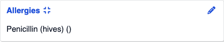 | 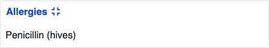 |
| Medical Problems | 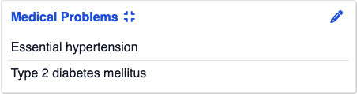 | 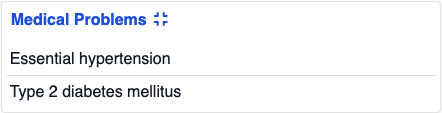 |
| Medications | 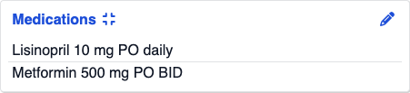 | 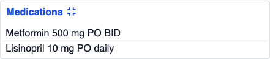 |
| Prescriptions | 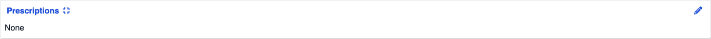 | 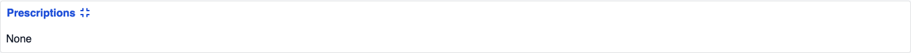 |
| Care Team | 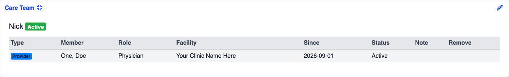 | 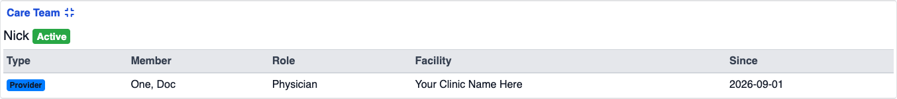 |
| Vitals | 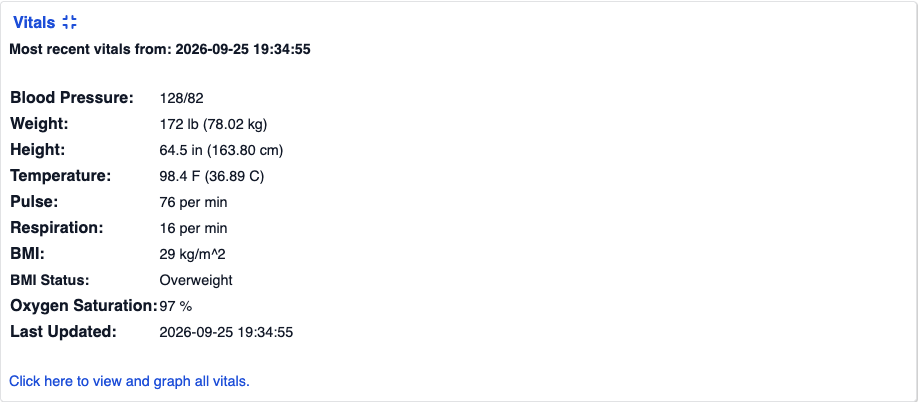 | 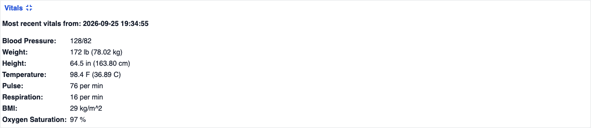 |

## 8. Security and HIPAA controls

- **Tokens stay on the server.** The authorization-code + PKCE flow keeps access and refresh
  tokens in the server-side session store. The browser holds one httpOnly, `SameSite=Lax` session
  cookie.
- **Minimum necessary.** Card responses carry display fields only. OpenEMR's response bodies and
  error text never reach the browser: every failure becomes a fixed `{error, message}`
  (`router.py`'s single error mapping). An upstream 401/403 → 403 "no access"; timeout → 504;
  anything else → 502.
- **Read-only.** The dashboard adds only read scopes (`user/CareTeam.read`,
  `user/Practitioner.read`, `user/Organization.read`, `user/RelatedPerson.read`) plus the
  standard OpenID Connect `openid` scope. It makes no non-GET calls to OpenEMR.
- **Patient ids never go in URL paths.** They travel only in query strings, and main's
  access-log filter strips query strings, so ids reach neither `request_timing.log` nor
  journald. They're parsed as UUIDs at the boundary (bad → 400).
- **Log hygiene.** Dashboard log lines carry only resource type, detail code, HTTP status and
  counts, and pass through the project's redaction layer (`app/log_redaction.py`). No Langfuse
  calls from dashboard code.
- **Headers on `/dashboard*` only** (so `/ui`'s fonts keep working):
  - CSP `default-src 'self'; script-src 'self'; style-src 'self'; img-src 'self' data:;
    font-src 'self'; connect-src 'self'; frame-ancestors 'none'; base-uri 'self';
    form-action 'self'`;
  - `X-Content-Type-Options: nosniff`;
  - `Referrer-Policy: no-referrer` (dashboard URLs carry `?patient=`);
  - `Cache-Control: no-store` on every API response.

  The build has no inline script or style (verified: 0 CSP violations, 0 console entries on a
  full load).
- **Sessions.** `POST /logout` (POST only, idempotent) drops the server session and deletes the
  cookie. A **server-side idle timeout** (default 7200 s, OpenEMR's own) applies to the dashboard
  and the Co-Pilot alike. No polling, so an idle tab really does go idle. When a session ends, the
  page clears its card data.
- **Paging links can't leak the token.** The BFF follows FHIR `next` links only when they match
  the configured FHIR base's scheme, host and path, with no `..`. Anything else is refused before
  a request is sent (`FhirClient.get_bundle_by_url`).
- **References can't steer requests.** Care-team member references are accepted only as a
  relative `Type/id` with a valid FHIR id, so they can't add path or query text to a read.
- **CSRF.** Every data route is `GET` and side-effect-free. The one state-changing route,
  `POST /logout`, relies on the `SameSite=Lax` cookie, which cross-site POSTs don't carry. A
  cross-site logout attempt carries no session and changes nothing. `/login`'s `next` is
  allow-listed to exactly `/ui` or `/dashboard` (no open redirect). The OAuth `state` isn't yet
  bound to the browser that started the login: a login-CSRF gap the project's threat model
  already tracks (`THREAT_MODEL.md` §4.10), inherited unchanged by the dashboard.
- **No `profile` scope.** It was tried for the "Signed in as <name>" line and dropped
  (2026-09-27): OpenEMR's consent controller passes through only `openid` and its SMART-required
  scopes (`fhirUser`, `offline_access`, `api:*`, …), so a browser login is never granted
  `profile`. The id_token carries only `sub`, and the top bar shows "Signed in", never an ID.
  With no `profile`, Co-Pilot's logs, traces and feedback keep recording the user's UUID exactly
  as before.
- **Accepted risk: plain HTTP on the droplet.** As with the Co-Pilot, the demo droplet serves
  HTTP. Cookies aren't marked `Secure` there (they would be dropped). TLS termination is future
  work (§11).
- **Isolation.** The dashboard instance uses its own OAuth client and cookie name (§4), so the two
  instances' sessions, cookies and consents stay separate.

## 9. Testing and CI

- **Backend, offline:** `cd clinical-copilot && .venv/bin/python -m evals.dashboard_unit_tests`,
  30 tests, the project's own runner convention (no pytest). Covers:
  - every card's filter and mapping rules;
  - paging, and the refused off-host `next` link;
  - the error mapping, with no upstream text in responses;
  - session and patient-id guards on every route;
  - idle timeout, logout, the `/dashboard` next URL, and the display-name claim rules;
  - CSP scoped to `/dashboard*`, and SPA serving;
  - the configurable cookie name.

  Mutation-checked for four controls: turning off the `/dashboard`-only CSP scope, the `next`-link
  guard, the 401 → forbidden mapping, or the idle timeout each makes its test fail.
- **Shared-code regression:** `python -m evals.unit_tests`, 288/288, with local OpenEMR.
- **CI:** `dashboard_checks` in `.gitlab-ci.yml` runs offline, starts immediately (`needs: []`) and
  doesn't touch the eval gate:
  - the tests above;
  - OpenAPI drift (`diff` against the committed `openapi.json`);
  - TypeScript type drift (`git diff --exit-code src/api/schema.d.ts`);
  - `npm run typecheck`;
  - `npm run build`.
- **Manual:** the checklist in `clinical-copilot/dashboard/BUILD_SPEC.md` §15, with results in
  `BUILD_LOG.md`.

## 10. Known limitations

- The FHIR fidelity gaps in §7 (rows 2, 7, 8, 10, 13, 18, 20, 21, 22).
- Care Team member *status* isn't available, so an inactive member is shown like an active one.
- Care Team member and facility **names need OpenEMR's `admin/users` ACL** over FHIR. Clinician
  accounts (like `test_clinician`) see "Name unavailable" (§7 row 20b).
- List medications entered with intent "order" appear under **Prescriptions** (§7 row 13a).
- Only OpenEMR's default theme and units setting are reproduced; translations aren't.
- Sessions are in memory: a restart logs users out, and there's one server process.
- Locally the page is slower than PHP: first card 1.34 s vs. 0.42 s, all cards 1.63 s vs. 1.15 s
  (§5.7).
- The top bar can't show the user's name ("Signed in" only): OpenEMR's consent doesn't pass
  `profile` through (§7 row 17). `fhirUser` + `user/Person.read` could provide it (future work).
- The dashboard depends on OpenEMR's OAuth client registration including its scopes. Unregistered
  scopes are silently dropped, which shows up as "You don't have access to this section".

## 11. Future work

- **Faster first paint:** one `/dashboard/api/page` call that fetches all cards server-side in
  parallel (one browser round trip), or render the header first and defer the rest. Either keeps
  per-card error states.
- **The signed-in name via `fhirUser`:** it's consent-forwarded; read the referenced
  `Practitioner` or `Person` for the name.
- **Its own OAuth client in code as well as deployment**, so the Co-Pilot's token never carries
  the dashboard's extra scopes when both run from one instance.
- **Editing:** through OpenEMR's REST API, with a separate write-capable client, per-field
  confirmation and patient re-verification.
- **Bootstrap 5 or MUI** by swapping the `components/ui/` wrappers.
- An embedded Co-Pilot panel (deliberately not linked today).
- A SMART on FHIR EHR launch from inside OpenEMR.
- TLS on the droplet.
- i18n using OpenEMR's translation tables.
- A patient-documents section.
- Honoring the `units_of_measurement` and theme settings.

## 12. Run it locally / deploy

```bash
# Backend (the Co-Pilot's FastAPI app, which also serves the dashboard)
cd clinical-copilot
.venv/bin/uvicorn app.main:app --host 127.0.0.1 --port 8420
# Frontend: production build, served by FastAPI at /dashboard
cd dashboard && npm ci && npm run build          # restart uvicorn after the first build
# Log in:  http://127.0.0.1:8420/login?next=/dashboard

# Hot reload instead (after logging in once on the FastAPI port, same host name):
DASHBOARD_API_TARGET=http://127.0.0.1:8420 npm run dev   # then open http://127.0.0.1:5173/dashboard/
```

Settings (all optional; see `clinical-copilot/.env.example`):
- `DASHBOARD_DEFAULT_PATIENT_ID`
- `SESSION_IDLE_TIMEOUT_SECONDS`
- `SESSION_COOKIE_NAME`
- `OPENEMR_TIMEZONE`

The OAuth client must have the four read scopes registered (see `clinical-copilot/README.md`'s
scope-retrofit pattern).

**Deploy:** a separate service on port 8430 (own checkout, venv, `.env`, OAuth client and cookie
name), built on the droplet with `npm ci && npm run build`. The step-by-step runbook is the
morning checklist at the top of `clinical-copilot/dashboard/BUILD_LOG.md`, and
`clinical-copilot/dashboard/BUILD_SPEC.md` §12 (whose "redeploy :8420" steps the isolation rule
replaces).
